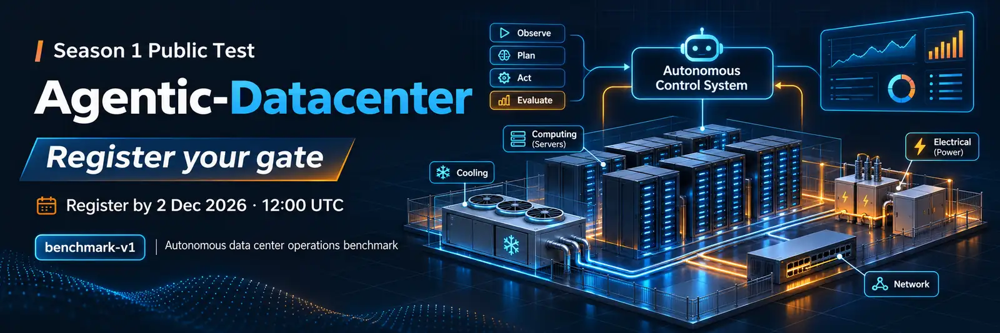

# Agentic-Datacenter

**Test AI-driven data center operations before they reach a real facility.**

A simulated data center with cooling failures, power disturbances and AI agents that propose control actions. Between the agent and the plant sits a safety control, a *gate*. Agentic-Datacenter shows what each decision does to the plant: what the gate stopped, what got through, and how often a person had to step in.

<p align="center">
  <a href="docs/media/agentic_datacenter_visual.mp4"></a>
</p>
<p align="center"><sub>A rendered, illustrative facility</sub></p>

<p align="center">
  <a href="#for-data-center-operators"><strong>Operators</strong></a> ·
  <a href="#for-gate-developers"><strong>Gate developers</strong></a> ·
  <a href="#how-long-a-test-takes"><strong>Test times</strong></a> ·
  <a href="#public-test-season-1"><strong>Season 1</strong></a> ·
  <a href="#documentation"><strong>Documentation</strong></a>
</p>

## Try it in a minute

[](https://codespaces.new/darklordVirtual/agentic-datacenter)

Or locally, with git, Python 3.12+ and [uv](https://docs.astral.sh/uv/):

```sh
git clone https://github.com/darklordVirtual/agentic-datacenter && cd agentic-datacenter
uv sync
uv run agentic-datacenter demo --scenario OP-03 --gate static_allowlist --out build/first-run
```

Open `build/first-run/index.html`: a chiller trip in a heat wave, with and without a safety control. No API keys, no external service.

## For data center operators

See what an AI agent would do to your plant before it gets near your control systems:

- **Temperatures:** what happens to IT supply air if an agent acts badly during a chiller trip, a utility loss or a leak.
- **Approvals:** which commands must never run without a person, and how often your staff would be asked.
- **Cost:** what a safety control costs in useful automation and energy.

<p align="center"><a href="docs/demo/result-report.md"></a></p>

**Start here:** the [operator guide](docs/guides/operators.md) (the chiller-trip example, the 23 scenarios and how to run them) and the [one-page result report](docs/demo/result-report.md) for decision makers.

> The facility is generic and simulated, and not calibrated against a real data center. A result shows how a decision plays out in this model, not what will happen at your site.

## For gate developers

Bring your own gate, in any language. Only `ALLOW` and `DENY` are required.

| Your project | Connect it as |
| --- | --- |
| Decides allow / deny, maybe escalate or abstain | HTTP service (`http_gate`), a command per decision (`command_gate`), or a Python package |
| Uses its own words (`permit`, `block`, `require_approval` …) | The same; your words are mapped to the four verdicts |
| Decides on the raw tool call | The same; read `tool_call` instead of `proposal` |
| Keeps budgets, quotas, rate limits or sessions | The same, with `ADC_GATE_STATEFUL=1` |
| Gives a score or risk number | A few lines that turn the score into a verdict at a fixed threshold |
| Observes or advises only | `ADC_GATE_PROFILE=SHADOW` |
| Signs receipts or evidence | Return your receipt id as `decision_id` |

```sh
export ADC_GATE_URL=http://127.0.0.1:8787  ADC_GATE_NAME=my_gate         # your service
uv run agentic-datacenter gate check http_gate                            # 1. check the connection
uv run agentic-datacenter bench run --tier quick --gate http_gate --gate static_allowlist --out build/try   # 2. a first result
```

**Start here:** [Bring your own gate](docs/guides/bring-your-own-gate.md) (step by step, with an [80-line example service](examples/http-gate/server.py)) and [Which way in for your project](docs/guides/which-way-in.md) (what is measured for each kind of project, and what is not there yet).

## How long a test takes

Test one scenario or a whole season. Every size uses the same scenarios, agents and judging.

| Size | What runs | Command | Time, measured |
| --- | --- | --- | --- |
| **One scenario** | 1 scenario, shortened, 1 seed | `--tier quick --scenario AD-03 --allow-unfrozen` | under a minute |
| **Quick** | all 23, shortened, 1 seed | `--tier quick` | 2 minutes |
| **Standard** | all 23 at full length, 3 seeds | `--tier standard` | about 1 hour |
| **Season** | all 23 at full length, 30 seeds | `--tier season` | 6 h 22 min |
| **Full** | all 23, 3 seeds, every refused command replayed to the end | `--tier full` | being timed |

- **Measured** on one machine with 16 threads, 9 to 15 runs at a time (`--jobs`). Quick with `static_allowlist`; standard and season with `remora_governed`. Standard needed about 14 GB of memory.
- **Longer** with a gate that keeps state (it is replayed from the start), or one that answers slowly over HTTP. `OP-10`, a simulated week, takes most of every full-length run.
- **Shorter** with `--jobs`, or by splitting a season over machines and merging the parts. The merged card is the same, byte for byte.
- **A part of the benchmark**, such as one scenario, is a development run and needs `--allow-unfrozen`; only every scenario of the frozen version can be a result.

More in [Tiers](docs/bench/TIERS.md) and [Run long benchmarks on a machine of your own](docs/guides/bench-runner.md).

## Public test: Season 1

[](https://github.com/darklordVirtual/agentic-datacenter/issues/new?template=gate-registration.yml)

**Registration closes 2 December 2026, 12:00 UTC.** Frozen benchmark `benchmark-v1`, open to any gate.

| 1 · Register | 2 · Connect | 3 · Benchmark |
| :-- | :-- | :-- |
| [Register your gate](https://github.com/darklordVirtual/agentic-datacenter/issues/new?template=gate-registration.yml) with its exact version. No setup needed yet. | Run `gate check` and add the output later. | Run the public tracks; submit your result card when ready. |

At the deadline the drand beacon emits round `34469812`, which draws the hidden variants of Track D. Nobody can know them before, the authors included. A gate changed after the deadline is a different gate. Rules: [Public test](docs/bench/PUBLIC_TEST.md).

| Gate | Project | Profile | Result |
| --- | --- | --- | --- |
| `null_gate` · `static_allowlist` | baselines: no gate; role and range checks | `UNGOVERNED` · `STATIC_ALLOWLIST` | development runs only |
| `remora` · `remora_governed` · `remora_shadow` | REMORA, [pinned](REMORA_PIN) | `DECISION_ONLY` · `GOVERNED` · `SHADOW` | development runs only |
| *your gate* | | | [register](https://github.com/darklordVirtual/agentic-datacenter/issues/new?template=gate-registration.yml) |

The built-in gates are written by Agentic-Datacenter's authors and reported apart. No benchmark result has been reported yet.

## Documentation

| | |
| --- | --- |
| **Use it** | [Operator guide](docs/guides/operators.md) · [Bring your own gate](docs/guides/bring-your-own-gate.md) · [Which way in](docs/guides/which-way-in.md) · [Command line](docs/reference/cli.md) |
| **Benchmark** | [Public test](docs/bench/PUBLIC_TEST.md) · [Tiers](docs/bench/TIERS.md) · [Fairness rules](docs/bench/FAIRNESS.md) · [Preregistration](docs/bench/PREREGISTRATION.md) · [Release check](docs/guides/release-gate.md) |
| **Reference** | [Words used here](docs/reference/glossary.md) · [Invariants](docs/reference/invariants.md) · [Design document](docs/design/SDD-ADC-001.md) · [Decisions](docs/design/adr/) |
| **Contribute** | [Calibration data](docs/calibration/contribute-data.md), for equipment makers and operators · [Contributing](CONTRIBUTING.md) |
| **Project** | [Changelog](CHANGELOG.md) · [Third-party notices](THIRD_PARTY_NOTICES.md) |

The simulated facility is generic. It is informed by how modular data centers are built and operated, and does not identify any particular facility or design document.

**Licence:** source-available under the Business Source License 1.1 ([LICENSE](LICENSE)). Development, testing, evaluation, demonstration and research are free; any other use, such as production, needs a [commercial licence](COMMERCIAL_LICENSING.md). The IEC 61850 package (`packages/agentic-datacenter-iec61850`) is licensed separately under GPLv3.
